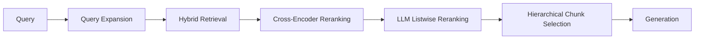

# Enterprise RAG 검색 최적화

- 사내 문서 51만 건에서 답을 찾는 RAG의 검색 실패 원인을 수치로 분해하고 개선한 프로젝트

## 결과

test 235문항 (test는 구성 결정에 쓰지 않음)

| 지표 | 임베딩 검색 | 혼합 검색 + 리랭커 | LLM 문서 선택 + 질의 확장 |
|---|---|---|---|
| **Recall@5** | 0.46 | 0.70 | **0.80** |
| 정답 문서를 모두 가져온 문항 | 43% | 65% | 74% |
| 질문과 문서가 다른 표현을 쓰는 유형(63문항)의 Recall@5 | 0.33 | 0.57 | 0.71 |

- Recall@5: LLM에 넘기는 청크 5개에 정답 문서가 든 비율
- 참고: 구성을 고른 dev에서는 Recall@5 0.48 → 0.72 → 0.84 (test보다 0.02~0.04 높음)

## 개요

| 항목 | 내용 |
|---|---|
| 데이터 | [EnterpriseRAG-Bench](https://github.com/onyx-dot-app/EnterpriseRAG-Bench). Onyx가 가상 회사의 Slack, 메일, 위키, 티켓 등 9종 사내 문서를 합성해 공개한 벤치마크. 문서 511,957개, 평가 문항 500개 |
| 정답 문서 | 벤치마크가 문항마다 지정한 근거 문서. 검색 성능 판단 기준 |
| 시나리오 | 사내 문서 외부 유출 불가 → 외부 API 없이 모든 모델을 로컬 GPU 1장(RTX A6000 48GB)에서 구동 |
| 모델 | 임베딩 Qwen3-Embedding-4B, 리랭커 bge-reranker-v2-m3, LLM Qwen3.8-27B-FP8 |
| 기술 스택 | Python, LangChain, LangGraph, Qdrant, vLLM, Docker |

## 문제 정의

이 절의 수치는 모두 dev 235문항 (구성 결정에 사용)

- 출발점: naive RAG
  - 문서를 512토큰 청크로 분할, 임베딩 검색(Dense) 상위 청크 5개를 LLM에 전달
  - Recall@5 0.48
- 검색부터 해결한 이유
  - 정답 문서를 모두 가져온 문항의 답 점수 0.57, 하나도 못 가져온 문항 0.05 (LLM이 정답과 대조해 매긴 0~1 점수)
  - 문서를 못 가져오면 LLM이 답할 방법 없음 → 검색을 첫 병목으로 설정
- 핵심 문제: Recall이 낮다는 사실만으로는 고칠 곳을 알 수 없음
  - 정답 문서 369건의 검색 순위 위치로 실패 유형 분해

| 정답 문서의 위치 | 비율 | 상태 | 필요한 해결 방향 |
|---|---|---|---|
| 1~5위 | 42% | 성공 | |
| 6~50위 | 20% | 찾았지만 순위가 낮음 | 순위 재조정 |
| 50위 밖 | 38% | 후보에도 없음 | 검색 방식 변경 |

- **더 큰 몫인 후보 부족(38%)은 순위 재조정으로 해결 불가** → 두 문제를 분리해 접근

## 해결 과정

이 절의 수치는 모두 dev 235문항 (구성 결정에 사용)

### 1단계: 후보 부족과 순위 문제 각각 해결 ([보고서](docs/experiments/round-1.md))

- 근거: 사전 분석에서 키워드 검색(BM25)이 임베딩 검색이 놓친 정답 문서 142건 중 72건 탐색
- 실험: BM25 단독, Dense와 BM25를 RRF로 합친 Hybrid 검색, Hybrid + Cross-Encoder 리랭커
- 결과: Recall@5 0.48 → 0.59(BM25) → 0.64(Hybrid) → 0.72(Hybrid + Reranker)

### 2단계: 남은 실패 재분해, "후보를 늘리면 된다" 가설 검증 ([보고서](docs/experiments/round-2.md))

- 관찰: 남은 실패는 "후보에 없음" 19%, "후보에 있지만 리랭커가 5위 밖에 둠" 17%
- 가설: 검색마다 가져오는 후보를 늘리면 후보에 없던 정답 문서가 들어와 Recall 상승
- 실험: 검색당 후보 수 50개 → 100, 200, 500개
- 결과
  - 후보 안에서 순위가 완벽할 때의 상한: 0.85 → 0.94로 상승
  - 실제 Recall@5: 0.70 수준에서 변화 없음
  - 질의 지시문 조정, 청크에 문서 제목 붙이기도 효과 없음
- 판단: **병목은 후보 수가 아니라 후보 중에서 고르는 단계(리랭커)**
  - 후보를 늘려도 리랭커가 정답 문서를 5위 안으로 올리지 못함

### 3단계: 고르는 단계 교체, 후보 넓히기와 결합 ([보고서](docs/experiments/round-4.md))

- 가설 1 (고르기)
  - Cross-Encoder는 질문과 청크 한 쌍씩 따로 점수를 매겨 후보끼리 비교 불가
  - 정답 문서가 여러 개인 유형에서 5위 청크(0.96)와 정답 문서(0.92)의 점수 차가 작아 구분 어려움
  - → 여러 문서를 한꺼번에 읽고 비교하는 LLM이 고르면 개선될 것
- 가설 2 (넓히기)
  - 가장 어려운 유형은 질문과 정답 문서가 공유하는 단어가 적음(내용어 겹침 0.41, 다른 유형 0.63)
  - Dense와 BM25 모두 정답 문서를 낮은 순위에 둠
  - → LLM이 질문을 문서 쪽 표현으로 바꿔 검색하면 찾을 것
- 결과

| 구성 | Recall@5 |
|---|---|
| 2단계까지 (Hybrid + Reranker) | 0.72 |
| + LLM이 20문서 중 5개 선택 | 0.76 |
| + 질의 확장만 | 0.72 (변화 없음) |
| + 질의 확장 + LLM이 40문서 중 5개 선택 | 0.84 |

- 판단
  - **질의 확장 단독은 2단계와 마찬가지로 효과 없음, 고르는 단계를 바꾼 뒤에야 넓힌 후보가 성과로 연결**
  - 2단계의 판단(병목은 고르는 단계) 확인
  - 가장 어렵던 유형이 0.53 → 0.71로 최대 상승

## 최종 파이프라인

[`configs/exp/r4-expand-select-chunks.yaml`](configs/exp/r4-expand-select-chunks.yaml)

1. **Query Expansion (Multi-Query, HyDE)**: LLM이 질문을 다른 표현의 검색어 8개와 답이 있을 법한 가상 문서 4개(Slack 대화, 회의록, 메일, 티켓 형식)로 확장
2. **Hybrid Retrieval (Dense + BM25, RRF)**: 원 질문과 확장문 12개를 각각 Dense, BM25로 검색(검색당 100개), 결과 26개를 문서 단위 RRF로 합쳐 상위 150문서 선정
3. **Cross-Encoder Reranking**: bge-reranker-v2-m3 점수와 검색 순위를 섞어 40문서로 축소
4. **LLM Listwise Reranking**: LLM이 40문서를 한꺼번에 읽고 질문에 필요한 5문서 선택
5. **Hierarchical Chunk Selection**: 고른 문서의 청크를 리랭커로 재평가해 LLM에 넘길 청크 5개를 고른 문서 안에서 선정(한 문서에서 여러 청크 가능)

- 청킹: 512토큰, 겹침 64토큰(RecursiveCharacterTextSplitter)
  - 색인 재생성에 하루 가까이 걸려 조정 없이 고정

## 평가 방법

- 데이터 분할
  - 500문항을 유형별로 반씩 나눠 dev 250, test 250
  - 분할 전 naive RAG를 500문항 전체로 1회 실행해 병목이 검색인지 확인
  - 이후 모든 비교와 결정은 dev로만 진행
  - test는 결정에 쓰지 않고, 결정이 끝난 뒤 보고할 세 구성(naive, Hybrid + Reranker, 최종)에만 1회씩 실행
- Recall@5
  - 문항마다 정답 문서 중 넘긴 청크 5개 안에 든 비율을 구해 평균
  - 정답 문서가 지정된 235문항 기준
- 비교 조건 고정
  - LLM에 넘기는 문맥을 청크 5개로 고정
  - 청크를 늘리면 Recall이 당연히 오르므로 같은 문맥 크기 안에서 비교
- 채택 기준
  - 같은 문항끼리 짝지어 비교하고, bootstrap으로 우연에 의한 차이를 걸러 확실히 개선된 후보만 채택
  - 차이가 불분명하면 더 단순한 구성 선택

## 한계

이 절의 수치는 모두 dev

- 비용: 검색 중 LLM 문항당 7회 호출, 검색 시간 문항당 0.61초(Hybrid + Reranker) → 20.42초
- 생성 단계
  - Recall@5를 0.48 → 0.72로 올렸을 때 답 점수도 0.30 → 0.42로 상승(답 프롬프트 동일)
  - 단, 정답 문서를 모두 가져온 문항의 답 점수는 두 구성 모두 0.57로 동일
  - 검색이 성공해도 답이 0.57에 머묾 → 남은 병목은 생성 단계
  - 이번 프로젝트 범위는 검색 단계까지
