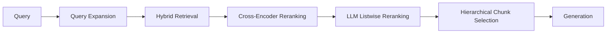

# Enterprise RAG 검색 최적화

- **무엇**: [EnterpriseRAG-Bench](https://github.com/onyx-dot-app/EnterpriseRAG-Bench)(가상 회사의 사내 문서 51만 건을 합성한 공개 벤치마크)로 사내 문서 QA RAG의 검색 단계를 개선한 포트폴리오 프로젝트, 외부 API 없이 로컬 GPU 1장에서 구동
- **문제**: 임베딩 검색만 쓰면 LLM에 넘기는 청크 5개에 근거 문서의 절반도 들어가지 않음 (Recall@5 0.46)
- **접근**: 단계마다 검색 실패를 원인별로 나눠 재고, 가장 큰 원인부터 해결
  1. 근거 문서가 후보에 아예 없음 → 키워드 검색을 더한 혼합 검색 / 후보에 있지만 순위가 낮음 → 리랭커
  2. 후보를 늘려도 Recall이 오르지 않음 → 병목을 "후보 중에서 고르는 단계"로 판단
  3. LLM이 후보 문서를 한꺼번에 비교해 고르게 바꾸고, 질의 확장으로 후보를 넓힘
- **결과 (test)**: Recall@5 0.46 → 0.80, 근거 문서를 하나도 못 가져온 문항 48% → 14%

## 개요

| 항목 | 내용 |
|---|---|
| 데이터 | EnterpriseRAG-Bench (Onyx 공개)<br>가상 회사의 Slack, 메일, 위키, 티켓 등 9종 사내 문서를 합성<br>평가 문항 500개 |
| 근거 문서 | 벤치마크가 문항마다 지정한, 답의 근거가 되는 문서 |
| 시나리오 | 사내 문서 외부 유출 불가 가정<br>→ 외부 API 없이 모든 모델을 로컬 GPU 1장에서 구동 |
| 실험 환경 | GPU: RTX A6000 48GB × 1 (CUDA 12.8)<br>vCPU 28, RAM 58GB<br>Ubuntu Server 24.04 LTS |
| 모델 | 임베딩: Qwen3-Embedding-4B<br>리랭커: bge-reranker-v2-m3<br>LLM (질의 확장, 문서 선택, 답 생성): Qwen3.8-27B-FP8<br>답 채점: gemma-4-26B-A4B-it-NVFP4 (자기 답을 자기가 채점하는 편향을 피하려고 생성 모델과 다른 모델 사용) |
| 색인 | 512토큰 청크, 겹침 64토큰 (RecursiveCharacterTextSplitter), 총 1,898,784개<br>Dense: Qdrant / BM25: Qdrant 희소 벡터 (Dense와 같은 컬렉션) |
| 기술 스택 | Python, LangChain, LangGraph, Qdrant, vLLM, Docker |
| 개발 도구 | Claude Code |

## 평가 방법

- 데이터 분할: 500문항을 유형 비율을 유지해 반씩 나눔 (dev 250, test 250)
  - dev: 실패 원인 분석, 기법 비교, 구성 결정에 사용
  - test: 구성 결정이 끝난 뒤 보고할 세 구성(naive, 혼합 검색 + 리랭커, 최종)에만 1회씩 실행
  - 분할 전 naive RAG를 500문항 전체로 1회 실행해 병목이 검색인지 확인, 분할 뒤 dev로 다시 재서 같은 결론 확인 ([문제 정의](#문제-정의)의 수치)
- 검색 지표 대상: 각 분할 250문항 중 근거 문서가 지정된 235문항
  - 나머지 15문항은 벤치마크가 근거 문서를 두지 않은 유형: High Level 5문항(답이 한 문서에 없는 고수준 질문), Info Not Found 10문항(답이 없는 질문)
  - 근거 문서가 없어 Recall을 계산할 수 없으므로 검색 지표에서 제외 (답 평가에서는 High Level 5문항은 답 점수에 포함, Info Not Found 10문항은 답 점수에서 빼고 "모르겠다"로 답했는지만 따로 확인)
- 비교 조건 고정: LLM에 넘기는 문맥을 청크 5개로 고정 (청크를 늘리면 Recall이 당연히 오르므로)
- 채택 기준: 같은 문항끼리 비교한 Recall@5 차이의 95% 신뢰구간이 0보다 크면 채택, 0을 걸치면 효과 불분명으로 보고 더 단순한 구성 유지

## 결과

- 수치는 모두 test 235문항 (dev로 구성을 정한 뒤 1회만 측정)
  - 구성을 고른 dev에서는 Recall@5 0.48 → 0.72 → 0.84 (test보다 0.02~0.04 높음)
- 오른쪽 열은 왼쪽 구성에 기법을 더한 누적 구성

| 지표 | 임베딩 검색<br>(naive) | + 혼합 검색<br>+ 리랭커 | + LLM 문서 선택<br>+ 질의 확장 (최종) |
|---|---|---|---|
| **Recall@5** | 0.46 | 0.70 | **0.80** |
| Precision@1 | 0.39 | 0.63 | **0.78** |
| MRR@5 | 0.44 | 0.68 | **0.81** |
| nDCG@5 | 0.41 | 0.66 | **0.79** |
| 근거 문서를 모두 가져온 문항 | 43% | 65% | 74% |
| 근거 문서를 하나도 못 가져온 문항 | 48% | 23% | 14% |

- Semantic 유형(63문항, 질문이 근거 문서와 다른 표현을 쓰는 유형)의 Recall@5: 0.33 → 0.57 → 0.71
- naive → 최종에서 Recall@5가 오른 문항 92개, 떨어진 문항 6개, 그대로인 문항 137개

## 문제 정의

이 절부터 해결 과정까지의 수치는 모두 dev 235문항

- 출발점: naive RAG
  - 문서를 512토큰 청크로 나누고, 임베딩 검색(Dense) 상위 청크 5개를 LLM에 전달
  - Recall@5 0.48
- 검색부터 해결한 이유
  - 근거 문서를 모두 가져온 문항의 답 점수 0.57, 하나도 못 가져온 문항 0.05 (LLM이 정답과 대조해 매긴 0~1 점수)
  - 문서를 못 가져오면 LLM이 답할 방법 없음 → 검색을 첫 병목으로 설정
- 실패 유형 분해
  - 근거 문서가 후보에 아예 없으면 검색 방식을 바꿔야 하고, 후보에 있는데 순위만 낮으면 순위를 다시 매기면 됨
  - 근거 문서 369건이 임베딩 검색에서 몇 위였는지로 분류
  - 경계: 5위 = LLM에 넘기는 청크 수, 50위 = 리랭커에 넘길 임베딩 검색 후보 수 (1단계에서는 BM25 50개와 함께 넘김)

| 근거 문서의 순위 | 비율 | 상태 | 해결 방향 |
|---|---|---|---|
| 1~5위 | 42% | 성공 | |
| 6~50위 | 20% | 후보에는 있지만 순위가 낮음 | 순위 재조정 (리랭커) |
| 50위 밖 | 38% | 후보에도 없음 | 검색 방식 변경 (키워드 검색 추가) |

- **더 큰 몫인 후보 부족(38%)은 순위 재조정으로 해결 불가** → 두 문제를 각각 해결

## 해결 과정

- 측정 → 원인 분해 → 해결안 후보 선정 → 실험·판정을 반복
- 해결안 후보는 모두 dev에서 실험, [채택 기준](#평가-방법)을 통과하지 못하면 기각

### 1단계: 후보 부족과 순위 문제 각각 해결 ([보고서](docs/experiments/round-1.md))

- 근거: 임베딩 검색이 놓친 근거 문서 142건 중 72건을 키워드 검색(BM25)이 찾음 (사전 분석)
- 결과

| 구성 | Recall@5 |
|---|---|
| 임베딩 검색 (기준) | 0.48 |
| BM25 단독 | 0.59 |
| 혼합 검색 (Dense + BM25, RRF) | 0.64 |
| 혼합 검색 + Cross-Encoder 리랭커 | **0.72** |

### 2단계: 남은 실패 재분해, "후보를 늘리면 된다" 가설 검증 ([보고서](docs/experiments/round-2.md))

- 관찰: 근거 문서 369건 중 5위 안은 227건(61.5%), 남은 실패는 "후보에 없음" 70건(19.0%), "후보에 있지만 리랭커가 5위 밖에 둠" 62건(16.8%), "순위가 완벽해도 청크 5개에 다 담지 못함" 10건(2.7%) (문서 단위라 문항마다 평균 내는 Recall@5와 기준이 다름)
- 가설: 검색마다 가져오는 후보를 늘리면 후보에 없던 근거 문서가 들어와 Recall 상승
- 실험: 검색당 후보 수 50개 → 100, 200, 500개
- 결과
  - 후보 안에서 순위가 완벽할 때의 상한: 0.85 → 0.94로 상승
  - 실제 Recall@5: 0.698~0.704로 기준(0.72)보다 오르지 않음
  - 질의 지시문 조정, 청크에 문서 제목 붙이기도 효과 없음
- 판단: **병목은 후보 수가 아니라 후보 중에서 고르는 단계(리랭커)**
  - 후보를 늘려도 리랭커가 근거 문서를 5위 안으로 올리지 못함

### 3단계: 고르는 단계 교체, 후보 넓히기와 결합 ([보고서](docs/experiments/round-4.md))

- 라운드 3은 답 프롬프트 실험이라 검색을 다루는 이 README에서는 생략
- 가설 1 (고르기)
  - Cross-Encoder는 질문과 청크 한 쌍씩 따로 점수를 매겨 후보끼리 비교 불가
  - 근거 문서가 여러 개인 유형에서 5위 청크(0.96)와 근거 문서(0.92)의 점수 차가 작아 구분 어려움 (Project Related 유형에서 후보에 있는데 놓친 근거 문서 기준 중앙값)
  - → 여러 문서를 한꺼번에 읽고 비교하는 LLM이 고르면 개선될 것
- 가설 2 (넓히기)
  - Semantic 유형은 질문과 근거 문서가 공유하는 단어가 적음 (내용어 겹침 0.41, 다른 유형 0.63)
  - Dense와 BM25 모두 근거 문서를 낮은 순위에 둠
  - → LLM이 질문을 문서 쪽 표현으로 바꿔 검색하면 찾을 것
- 결과 (모든 행은 혼합 검색 + 리랭커 위에 추가한 구성)

| 질의 확장 | LLM 문서 선택 | Recall@5 |
|---|---|---|
| – | – | 0.72 |
| – | 20문서 중 5개 | 0.76 |
| – | 40문서 중 5개 | 0.79 |
| ✓ | – | 0.72 |
| ✓ | 40문서 중 5개 | **0.84** |

> 0.76 → 0.84 중 후보 수(20 → 40) 효과 +0.03, 그 위에 질의 확장 +0.05 (둘 다 신뢰구간이 0 위). 질의 확장 행은 검색당 후보 수 등 설정도 함께 다름

- 판단
  - **질의 확장 단독은 2단계와 마찬가지로 효과 없음, 고르는 단계를 바꾼 뒤에야 넓힌 후보가 성과로 연결**
  - 2단계의 판단(병목은 고르는 단계) 확인

## 최종 파이프라인

[`configs/exp/r4-expand-select-chunks.yaml`](configs/exp/r4-expand-select-chunks.yaml)



1. **Query Expansion (Multi-Query, HyDE)**: LLM이 질문을 다른 표현의 검색어 8개(정보 조각별 4개, 다른 표현 4개를 각각 한 번씩 요청)와 답이 있을 법한 가상 문서 4개(Slack 대화, 회의록, 메일, 티켓 형식, 종류마다 한 번씩 요청)로 확장
2. **Hybrid Retrieval (Dense + BM25, RRF)**: 원 질문과 확장문 12개를 각각 Dense, BM25로 검색(검색당 100개), 결과 목록 26개(질의 13개 × Dense·BM25)를 문서 단위 RRF로 합쳐 상위 150문서 선정
3. **Cross-Encoder Reranking**: bge-reranker-v2-m3 점수와 검색 순위를 섞어 40문서로 축소
4. **LLM Listwise Reranking**: LLM이 40문서를 한꺼번에 읽고 질문에 필요한 5문서 선택
5. **Hierarchical Chunk Selection**: 고른 문서의 청크를 리랭커로 재평가해 LLM에 넘길 청크 5개를 고른 문서 안에서 선정(한 문서에서 여러 청크 가능)

## 한계

이 절의 수치는 모두 dev

### 비용

- 검색 중 LLM을 문항당 7회 호출 (검색어 2회: 틀 2개 × 4개씩, 가상 문서 4회, 문서 선택 1회), 검색 시간 문항당 20.42초 (혼합 검색 + 리랭커는 0.61초, [개요](#개요)의 실험 환경 기준)

### 생성 단계

- naive → 최종: Recall@5는 0.48 → 0.84로 올랐지만, 답 점수는 0.30 → 0.51
- 근거 문서를 모두 가져온 문항의 답 점수도 0.57(naive) → 0.60
  - 검색이 성공해도 틀리는 답이 남음 → 다음 병목은 생성 단계

## 실행 방법

```bash
# 1. 의존성
uv sync
cp .env.example .env            # DOCS_DIR(문서 폴더), EVAL_FILE(평가 파일), HF_HOME(모델 폴더), QDRANT_STORAGE(Qdrant 저장 폴더)를 장비에 맞게 수정. 전송 차단 변수는 그대로 둠

# 2. Qdrant, vLLM 서버 실행 (처음 한 번은 start 대신 download로 모델을 받음)
uv run --env-file .env python -m rag.serve start qdrant
uv run --env-file .env python -m rag.serve start embed
uv run --env-file .env python -m rag.serve start rerank
uv run --env-file .env python -m rag.serve start gen      # 질의 확장, 문서 선택

# 3. 색인 (약 17시간, 문서 1,000개로 잰 속도에서 환산)
# 별도 명령 없음. 4번의 retrieve가 같은 조건의 색인이 Qdrant에 없으면 먼저 만듦

# 4. 최종 구성 평가
uv run --env-file .env python -m rag.retrieve configs/exp/r4-expand-select-chunks.yaml
# → runs/retrieve/r4-expand-select-chunks/<시각>/ 에 문항별 점수(scores.jsonl)와 평균(metrics.json)

# 5. 테스트
uv run --env-file .env.example pytest
```

## 코드 구조

```
configs/exp/        실험 구성 (yaml 1개 = 실험 1개)
docs/experiments/   라운드별 실험 보고서
prompts/            LLM 프롬프트 (질의 확장, 문서 선택 등)
src/rag/            색인·검색·리랭킹·생성 파이프라인
tests/              테스트
CLAUDE.md           Claude Code 작업 규칙
```

## 개발 방식

- 역할 분담 (`CLAUDE.md`)
  - 개발자: 범위 결정, 설계안과 실험 후보 선택·승인, 위험 수용 판단, 머지 지시
  - Claude Code: 실패 원인 분석과 후보 제안, 코드·테스트 작성, 실험 실행, 보고서 초안
- 작업 단위
  - 설계와 분할 계획(`docs/design.md`, `docs/plan.md`)을 먼저 승인받은 뒤, 한 가지 일만 하는 단위로 구현 (코드와 테스트는 같은 단위)
  - 단위마다 브랜치 → 사전 리뷰 → PR → squash 머지
- AI 산출물 검증
  - 승인 지점 4개: 설계·분할 계획, 예외(단위 크기 초과, 새 의존성, 범위 확장), 단위 사전 리뷰(승인 전 push·PR 금지), 머지(지시할 때만). "승인", "LGTM", "진행"이라고 명시했을 때만 승인으로 봄
  - 사전 리뷰: 꼭 리뷰할 것(위치와 확인 질문), 검증 명령의 원본 출력, 로직을 일부러 깨뜨렸을 때 실패하는 테스트, 5분 안에 직접 돌려 볼 명령
  - 단위마다 `pytest`, `ruff check`, `ruff format --check` 실행 (CI 없이 사전 리뷰에서 출력 확인)
  - 버그 수정은 재현 테스트가 수정 전에 실패하는 것을 먼저 확인
- test 분할 격리 (`docs/optimization.md`)
  - 시드를 고정해 분할(`python -m rag.split`), 모든 비교와 결정은 dev로
  - `.env`의 평가 파일은 dev, test는 이름이 `test-`로 시작하는 config로만 평가 파일을 바꿔 실행
  - test 결과를 보고 구성을 고치지 않음
